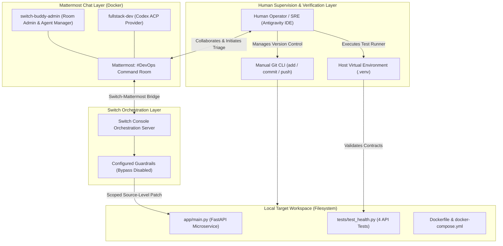

# DevOps Command Room AI: Architecture & Operational Workflow

Technical Architecture, Multi-Agent Collaboration, and Human-in-the-Loop Governance for the **Flip the Switch Hackathon**.

---

## 1. Executive Overview & Hackathon Problem Statement

Modern software operations face a fundamental shift: autonomous AI agents are increasingly capable of code analysis and generation, but in enterprise DevOps environments, standalone agents running without guardrails introduce operational risk. A solo AI agent attempting code patches in isolation lacks contextual situational awareness, human oversight, and verifiable security boundaries.

**DevOps Command Room AI** addresses this challenge by shifting the paradigm from **isolated autonomous agents** to **collaborative team members within a structured incident command center**.

By uniting:

- **Switch Console** as the local multi-agent orchestration fabric,
- **Mattermost** as the persistent, team-visible incident collaboration room,
- **fullstack-dev (Codex ACP Provider)** as a specialized developer agent,
- **switch-buddy-admin** as the room administrator and agent manager, and
- **Antigravity IDE & Human SRE** as the authoritative verification and governance layer,

the architecture demonstrates how a simulated production incident initiated and triaged by a human operator and agentic code resolution take place under configured workspace boundaries, transparent execution limits, and human-in-the-loop validation.

---

## 2. System Architecture Diagram

### ASCII System Architecture

```text
+-----------------------------------------------------------------------------------------+
|                                    HUMAN OPERATOR / SRE                                 |
|  (Antigravity IDE / Local Terminal / Virtual Environment (.venv) / Git Version Control) |
+------------------------------------+------------------------------------+---------------+
                                     |                                    ^
                 Incident Escalation | Chat / Dispatch                    | Verification
                 & Operational Review|                                    | & Manual Commit
                                     v                                    |
+-------------------------------------------------------------------------+---------------+
|                                    MATTERMOST (DOCKER)                                  |
|                               Channel: #DevOps Command Room                             |
|                                                                                         |
|   +-----------------------------+               +-----------------------------------+   |
|   |    switch-buddy-admin       |               |          @fullstack-dev           |   |
|   | (Room Admin & Agent Manager)|               |   (Codex ACP Scoped Dev Agent)    |   |
+---+--------------+--------------+---------------+-----------------+-----------------+---+
                   |                                                |
                   +-----------------------+------------------------+
                                           |
                                           | Switch-Mattermost Bridge
                                           v
+-----------------------------------------------------------------------------------------+
|                               SWITCH CONSOLE DESKTOP APP                                |
|                        (Local Switch Orchestration Server)                              |
|   * Workspace Path Restriction: devops-command-room-ai                                  |
|   * Bypass Mode: Disabled                                                               |
|   * Approval Checks: Enforced                                                           |
+-------------------------------------------------+---------------------------------------+
                                                  |
                                                  | Scoped Source-Level Modifications
                                                  v
+-----------------------------------------------------------------------------------------+
|                               SCOPED LOCAL WORKSPACE FILES                              |
|  devops-command-room-ai                                                                 |
|                                                                                         |
|   |-- app/                                      |-- tests/                              |
|   |   |-- __init__.py                           |   |-- __init__.py                     |
|   |   `-- main.py (Target Microservice)         |   `-- test_health.py (4 API Tests)    |
|   |-- requirements.txt                          |-- Dockerfile                          |
|   `-- docker-compose.yml (service: devops-api)                                          |
+-----------------------------------------------------------------------------------------+
```

### Mermaid Architecture Flowchart



---

## 3. Technology Stack & Component Responsibilities Matrix

| Component | Technology / Platform | Execution Context | Core Responsibilities |
| --- | --- | --- | --- |
| **Target Microservice** | Python 3.11+ / FastAPI / Uvicorn | Local Workspace & Docker (`devops-api`) | Serves simulated service endpoints (`GET /`, `GET /health`). Simulates degradation states via environment configuration. Does not send automated alerts. |
| **Automated Test Suite** | Pytest / Starlette `TestClient` | Local Python Virtual Environment (`.venv`) | Executes 4 automated API tests validating root status, explicit health overrides, and baseline fallback behaviors. |
| **Room Administrator** | `switch-buddy-admin` | Mattermost Channel Bot | Mattermost room administrator and agent manager. |
| **Developer Agent** | `fullstack-dev` (Codex ACP Provider) | Switch Console agent execution | Inspects source files, diagnoses the root cause of the `HTTP 500` degradation, and applies source-level code modifications to `app/main.py`. |
| **Orchestration Fabric** | Switch Console Desktop App | Local Orchestration Runtime | Bridges Mattermost conversations to agent tools; Switch Console applies the configured workspace path restriction and approval settings. |
| **Collaboration Room** | Mattermost | Mattermost (Docker) | Houses the persistent `#DevOps Command Room` channel where incident triage, agent assignment, and status updates are discussed. |
| **Human Operator** | Antigravity IDE & Terminal | Host Operating System | Initiates simulated incident triage, conducts independent verification, runs test suites inside `.venv`, and manages version control (`git add`, `git commit`). |

---

## 4. Security & Configured Guardrails

To prevent unintended modifications and maintain operational boundaries during incident response, Switch Console uses configured guardrails:

1. **Enforced Workspace Path Restriction:**
   - The developer agent (`fullstack-dev`) is configured with a workspace path restriction to the project root directory (`devops-command-room-ai`).

2. **Bypass Mode Explicitly Disabled:**
   - Safety guardrail bypass mode is explicitly turned off.

3. **Approval Checks Enforced:**
   - Tool execution approval checks remain enabled throughout the session.

4. **Transparent Execution Boundaries:**
   - The agent inspected source files and applied source-level code modifications directly to `app/main.py`.
   - The agent's test execution attempt was unsuccessful due to a host Python interpreter path access boundary involving the host `.venv`.
   - Authoritative verification was completed independently by the Human SRE using the local `.venv` environment.

---

## 5. Understanding the Three Runtime & Incident States

To evaluate the system behavior and test outcomes accurately, the architecture distinguishes three separate runtime states:

### A. Resolved Main Branch
- The current resolved `main` branch defaults to `SERVICE_STATUS=healthy` in `app/main.py`.
- Running the automated API test suite passes all contract checks: `4 passed, 1 warning`.
- The local default `/health` endpoint returns HTTP 200 (`{"status":"healthy","uptime_s":3600}`).

### B. Demo Incident Branch
- Baseline scaffold commit: `2797ccf`.
- Demo branch name: `demo/incident-resolution` (to be created by the human operator from commit `2797ccf` for demonstration purposes).
- In this baseline state, `app/main.py` defaults to `SERVICE_STATUS=degraded`.
- Running the automated API test suite on this baseline produces an intentional failure on the default health check: `1 failed, 3 passed` (expects HTTP 200, receives HTTP 500).
- This reproduces the simulated production incident for live hackathon demonstration without altering the main branch history.

### C. Docker Compose Simulated Degradation
- `docker-compose.yml` explicitly injects `SERVICE_STATUS=degraded`.
- This setting deliberately overrides the application's default inside the container.
- When running under Docker Compose, `GET /health` returning HTTP 500 with `{"detail":"Service degraded: memory leak detected"}` is the expected simulated container behavior, proving environment-variable injection functions as intended rather than indicating a failure of the resolved main branch.

---

## 6. Incident Triage & Resolution Lifecycle

The incident workflow models an end-to-end DevOps triage loop with clear role attribution:

```text
[1. Incident Initiation]
  - Human operator initiates simulated incident triage where the baseline exposes HTTP 500 on default health check
       |
       v
[2. Mattermost Triage Thread]
  - Human Operator reports incident in #DevOps Command Room with switch-buddy-admin
  - @fullstack-dev is dispatched to investigate the regression
       |
       v
[3. Agent Inspection & Root Cause Diagnosis]
  - fullstack-dev reads app/main.py and tests/test_health.py
  - Agent diagnoses that os.getenv("SERVICE_STATUS", "degraded") causes unconfigured runs to return HTTP 500
       |
       v
[4. Scoped Patch Application]
  - fullstack-dev writes fix to app/main.py by changing fallback to os.getenv("SERVICE_STATUS", "healthy")
  - Agent's pytest execution attempt is unsuccessful due to a host Python interpreter path access boundary
       |
       v
[5. Independent Human Verification]
  - Human Operator executes independent local verification in .venv:
    .\.venv\Scripts\python.exe -m pytest -q
  - All 4 automated API tests pass (4 passed, 1 warning)
       |
       v
[6. Authoritative Git Commit]
  - Human Operator reviews git diff, stages changes, and commits:
    git commit -m "fix: resolve default health check incident"
```

### Role Attribution Summary

- **Agent Action:** Diagnosed the bug, inspected files, and applied source-level code modifications to `app/main.py`.
- **Execution Boundary:** The agent's test execution attempt was unsuccessful due to a host Python interpreter path access boundary involving the host `.venv`.
- **Human Action:** Initiated simulated triage, reported the incident in Mattermost, ran independent verification inside `.venv`, evaluated the test output, and performed Git version control operations.

---

## 7. Reproducibility & Local Runbook

Follow these steps to reproduce the target microservice, execution environment, and test validation.

### Step 1: Clone & Environment Setup

Ensure Python 3.11+ is installed.

```bash
git clone <YOUR_PUBLIC_REPOSITORY_URL>
cd devops-command-room-ai
```

In PowerShell:

```powershell
# Create virtual environment
python -m venv .venv

# Activate virtual environment
.\.venv\Scripts\Activate.ps1

# Install project dependencies
pip install -r requirements.txt
```

### Step 2: Executing Automated API Tests

Run the automated API test suite through the virtual environment:

```powershell
.\.venv\Scripts\python.exe -m pytest -q
```

Expected output upon incident resolution:

```text
....                                                                     [100%]
4 passed, 1 warning
```

### Step 3: Local Microservice Execution

Run the service directly via Uvicorn:

```powershell
uvicorn app.main:app --host 0.0.0.0 --port 8000 --reload
```

Test the simulated service endpoints:

- `Invoke-RestMethod -Uri http://localhost:8000/` returns `{"status":"online","system":"DevOps Command Room"}`
- `Invoke-RestMethod -Uri http://localhost:8000/health` returns `{"status":"healthy","uptime_s":3600}`

### Step 4: Containerized Validation (Docker Compose)

Validate the containerized deployment:

```bash
# Build and start container
docker compose up --build -d

# Verify root endpoint
curl http://localhost:8000/

# Verify health endpoint (Expected Simulated Degradation)
curl http://localhost:8000/health
```

> [!NOTE]
> Because `docker-compose.yml` explicitly injects `SERVICE_STATUS=degraded`, running `curl http://localhost:8000/health` returning **HTTP 500** with `{"detail":"Service degraded: memory leak detected"}` is the **EXPECTED** simulated container behavior, proving that containerized environment variable injection works as designed.

To tear down the container:

```bash
docker compose down
```
